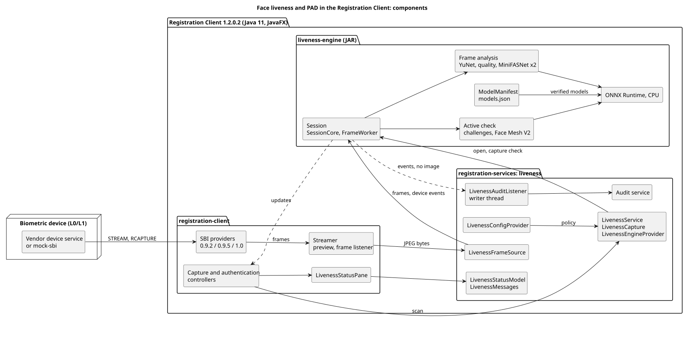

# Architecture

Status on 19 October 2026: the engine and the three workflows are implemented: resident face capture with the exception process after the last attempt, operator and supervisor face authentication. The check on screen with the simulated device and a MOSIP environment is still to do. The client changes are on the `feature/face-liveness` branch of the team's fork of `registration-client`, based on release 1.2.0.2.

## 1. Context

The solution targets the desktop Registration Client, release 1.2.0.2 (Java 11, JavaFX). Face devices are reached through the MOSIP Secure Biometric Interface (SBI): the client opens a frame stream with the `STREAM` request and asks for the final image with `RCAPTURE`.

Release 1.2.0.2 shows the stream as a preview and starts the capture at the same moment. Nothing checks that the face in front of the device is live, and the same holds for the face authentication of operators and supervisors.

The solution places a liveness and presentation attack detection (PAD) gate between the stream and the capture, in the three workflows, without any network dependency.

## 2. Components

Source: [diagrams/components.puml](diagrams/components.puml)

### 2.1 In the Registration Client

| Component | Module, class | Existing or new | Role |
| --- | --- | --- | --- |
| Biometric device, real or simulated | Vendor device service, or `mock-sbi` of this repository | Existing, plus `mock-sbi` | Provides the frame stream and the captured image over SBI |
| SBI providers | `MosipDeviceSpecificationProvider` and its implementations for 0.9.2, 0.9.5 and SBI 1.0 | Existing, unchanged | Common device abstraction of the client. Keeps the solution independent of the device vendor. Validates the signature of `RCAPTURE` responses |
| Stream reader | `Streamer` (registration-client) | Existing, small change | Reads the multipart JPEG stream and updates the preview. Passes the bytes of each frame to an optional `StreamFrameListener`, closes the stream when the device ends it, and never lets a listener error reach the preview |
| Frame source adapter | `LivenessFrameSource` (registration-services) | New | Turns frames and device errors into `submit` and `deviceEvent` calls on the session, with a monotonic clock. Ignores the end of the stream once the capture is requested |
| Liveness service | `LivenessService`, `LivenessEngineProvider`, `LivenessCapture`, `AttemptOffsetListener` (registration-services) | New | Creates the engine on first use, runs one scan per session, counts the attempts of a face field across scans, checks the captured image, and refuses a capture response that does not hold exactly one face record |
| Configuration provider | `LivenessConfigProvider`, `LivenessConfig` (registration-services) | New | Reads the 17 keys of [configuration.md](configuration.md) through `ApplicationContext`: workflow key, then general key, then engine default. An invalid value falls back to the default |
| Messages | `LivenessMessages`, `LivenessStatusModel` (registration-services) | New | Message keys and screen state of each update. A detected attack shows the generic message |
| Status pane | `LivenessStatusPane`, `liveness.css` (registration-client) | New | Shows the band, the instruction, the position of the challenge, the progress, the liveness status and the buttons of the screens of [ui/README.md](ui/README.md) |
| Capture and authentication controllers | `GenericBiometricsController` for the resident; login and authentication controllers (#23) | Existing, modified | Start a scan, show its updates, send `RCAPTURE` only after `PASSED` |
| Audit | `LivenessAuditListener` (registration-services), `AuditEvent`, `AuditManagerService` | Existing, extended | Writes the eight liveness events of section 9 of [decision-flow.md](decision-flow.md) on a writer thread of its own, so the engine never waits for the database |

### 2.2 In the engine

`liveness-engine` is a separate Maven module and JAR, `io.mosip.registration:liveness-engine`. It has no dependency on Registration Client classes or on JavaFX. It receives encoded or decoded frames and a policy, and returns updates, events and the result of the capture check. Its API is described in [engine-api.md](engine-api.md).

| Package | Role |
| --- | --- |
| `api` | Public API: `LivenessEngine`, `LivenessSession`, `LivenessPolicy`, `LivenessUpdate`, `LivenessEvent`, `CaptureCheck`, `LivenessEventListener`, `FrameDecoder`, and the enums of states, feedback, tips, failure reasons and device events |
| `session` | `DefaultLivenessEngine`, `DefaultLivenessSession`, `SessionCore` (state machine), `FrameWorker` (single analysis thread), `FaceTracker`, `MetricsRecorder` |
| `passive` | Classifier crop, MiniFASNet inference, quality checks, frame analysis, median window |
| `active` | Challenge generator, challenge runner, blink, smile and head turn detectors |
| `face` | YuNet detector, Face Mesh V2 landmarks |
| `image` | BGR image and resize, in plain Java |
| `model` | `ModelManifest`: checks the four models against `models.json` (size and SHA-256) before loading them from the verified bytes |
| `platform.desktop` | `ImageIoFrameDecoder`: JPEG and PNG decoding with `javax.imageio`, the only package that uses desktop imaging classes |

## 3. Frame flow

1. The controller asks `LivenessService` for a scan. The service reads the policy of the workflow, gets the engine and opens a session.
2. The controller starts the face stream of the selected device, with the frame source of the scan as listener of `Streamer`.
3. `Streamer` reads each JPEG frame, displays it and passes its bytes to `LivenessFrameSource`, which submits them with a monotonic timestamp.
4. The session analyses frames on its worker thread. A frame that arrives while another one is being analysed, or less than `frame.sampling_ms` after the last one, is skipped, so the preview never waits for the analysis.
5. After each analysed frame, the session sends an update to its listener on the worker thread. The controller hands it to the JavaFX thread with `Platform.runLater`, where `LivenessStatusPane` shows it. Events go to `LivenessAuditListener`, which writes them on its own thread.
6. When the session reaches `PASSED`, the controller sends `RCAPTURE`. The client converts the ISO 19794-5 record of the response to pixels with the MOSIP face decoder, and the session checks the image (section 6 of [decision-flow.md](decision-flow.md)) before it is accepted.
7. A refused capture never reaches the registration. The attempt is counted, and the screen offers a new attempt while attempts are left.

## 4. Decision flow

Session states: `INIT`, `PASSIVE_CHECK`, `ACTIVE_CHALLENGE`, `PASSED`, `FAILED`.

1. **Frame filtering.** A frame with no face, several faces or insufficient quality gives guidance to the user and does not count for the score.
2. **Passive check.** Once enough good frames are collected, the median of their scores over the window is compared with two thresholds:
   - at or above the pass threshold: liveness is established with no user action;
   - at or below the attack threshold: presentation attack, immediate failure;
   - between the two: the active check starts on its own.
3. **Active check.** The session draws the configured number of challenges with `SecureRandom` among the enabled types (blink, smile, head turn left, head turn right). For each one it measures a baseline, shows the instruction and expects the action before a timeout. The action must happen after the instruction is shown, which a replayed video cannot anticipate.
4. **Controls during the active check.** The passive score keeps being computed and still triggers a failure below the attack threshold. Losing the face, a second face or an inconsistent jump of the face box ends the attempt.
5. **Check of the captured image.** The image returned by `RCAPTURE` must contain one face, outside the attack zone, consistent in position and size with the last face followed in the stream.
6. **Attempts.** After a failure a new attempt is possible until the configured maximum. A resident then goes to the exception process, an operator or a supervisor signs in another way.

The passive classifier and its preprocessing are described in [../training/README.md](../training/README.md). The complete rules, with thresholds, action detection, feedback codes and audit events, are in [decision-flow.md](decision-flow.md).

## 5. Workflows and integration points

| Workflow | Class in `registration-client` | Point of integration | Status |
| --- | --- | --- | --- |
| Resident face capture | `GenericBiometricsController` | Liveness scan before `rCaptureTaskService()`, which runs only after `PASSED`. Captured image checked inside the capture task | Implemented (registration-client#6, pane in #8) |
| Exception process after the last attempt of a resident | `GenericBiometricsController`, reviewer authentication of `AuthenticationController` | "Continue under exception": one capture without a liveness decision, liveness exception mark, supervisor authentication at submission, by face only when liveness is enabled for the supervisor | Implemented (registration-client#9, #13) |
| Operator login by face | `LoginController` | A `PASSED` session before the face is captured and matched. Failed liveness attempts count as failed logins | Implemented (registration-client#10) |
| Operator and supervisor authentication | `AuthenticationController`, `BaseController.captureAndValidateFace(...)` | Liveness before the capture, captured image checked before `authValidator(...)`. The supervisor policy for reviewers | Implemented (registration-client#10) |
| End of day approval by the supervisor | `EODAuthenticationController` | Same entry point, with the supervisor policy | Implemented (registration-client#10) |

Other modalities (fingerprints, iris) and the exception photo keep their behaviour. With liveness disabled by configuration, the client behaves as release 1.2.0.2 and the engine is never loaded.

The sequence diagrams of the three workflows, and the change at each step, are in [workflows.md](workflows.md).

## 6. Configuration

Liveness keys use the prefix `mosip.registration.face.liveness.` and follow the existing mechanism: values are synchronised from the server configuration when the client is online, stored locally, and read through `ApplicationContext`. They sit next to the existing face keys such as `mosip.registration.face_threshold` and `mosip.registration.num_of_face_retries`.

The keys cover: enabling liveness, the two passive thresholds, the window, sampling and quality limits, enabling the active check, the minimum number of challenges, the challenge types, the challenge timeout and baseline, the maximum number of attempts, the behaviour when attempts are exhausted, and a diagnostic mode.

A workflow can override any key by inserting its name after the prefix, for example `mosip.registration.face.liveness.supervisor.active.min_challenges`. The workflow value wins over the general one. If a key is missing, for instance on a first installation that has never synchronised, the defaults of the engine apply. Details, ranges and validation rules are in [configuration.md](configuration.md).

## 7. Online and offline operation

Liveness, PAD, challenge selection and action validation run inside the Registration Client process. The models are packaged in the engine JAR. No frame leaves the workstation and no network call is made for a liveness decision, so the behaviour is identical online and offline. Only configuration updates need connectivity, through the client's existing synchronisation.

## 8. Security and privacy

- When a presentation attack is detected, the screen shows a generic message. The reason goes to the audit trail only.
- Logs and audit entries carry codes, durations and the model set version. They never carry an image or biometric data.
- Challenges are drawn with `java.security.SecureRandom`.
- The engine checks its four models against `models.json` before loading them, and refuses to start on any difference.
- A capture response is accepted only when it holds exactly one face record, and that image passes the capture check.
- The signature validation of SBI responses is left untouched.
- Injection of a forged stream before the client is outside the scope of presentation attack detection. It depends on device integrity, which the signed responses of L1 devices address in part.

The full analysis is in [security-privacy.md](security-privacy.md).

## 9. Technology choices

| Topic | Choice | Reason |
| --- | --- | --- |
| Engine language | Java 11, standalone Maven module | Must load in the JVM of Registration Client 1.2.0.2 |
| Inference | ONNX Runtime 1.19.2 for Java, CPU | One runtime for all models, which are exported from PyTorch and TFLite |
| Image processing | Plain Java on decoded pixel arrays. JPEG decoding in a platform adapter (`ImageIO` on the desktop) | No extra native dependency. The resize reproduces the reference arithmetic. The core stays free of `java.awt` and `javax.imageio`, which do not exist on Android |
| Passive classifier | MiniFASNetV2 and MiniFASNetV1SE, from Silent-Face-Anti-Spoofing (Apache-2.0) | Small pretrained models, about 1.8 MB each |
| Face detector | YuNet `2023mar`, from OpenCV Zoo (MIT), 0.23 MB | Small and fast, gives five keypoints. Its box is turned into a square of the same area before the classifier crop, to match the boxes MiniFASNet was trained with |
| Landmarks for the active check | MediaPipe Face Mesh V2 (Apache-2.0), converted to ONNX, 4.8 MB | 478 points with eye and mouth contours, needed for blink, smile and head turn. Its model card reports similar accuracy across regions and skin tones |
| Threads | One analysis thread per session, one audit writer thread, the JavaFX thread for display only | The preview and the screen never wait for an analysis or a database write |
| Simulated device | `mock-sbi`, a fork of MockMDS 1.2.0.2 with a webcam mode | Development without hardware, end-to-end runs of the SBI protocol |
| Diagrams | PlantUML | Versioned as text |

The comparison behind the detector and landmark choices, the model contracts and the measurements on sample images are in [../training/README.md](../training/README.md). On the reference machine, the three models together take about 50 to 70 ms per frame in Python on CPU; the Java timings are followed in #29.

## 10. Android

No Android code is part of the current scope. The Android Registration Client receives no frame stream: the SBI application holds the camera and returns only the captured image. [android.md](android.md) compares the options, recommends running liveness in the client with the tablet camera before the capture, and lists the requirement this puts on the engine: a core that works on decoded pixels, with no desktop imaging classes. The engine meets it: `checkCapture` accepts decoded pixels, and only `platform.desktop` uses `javax.imageio`.
